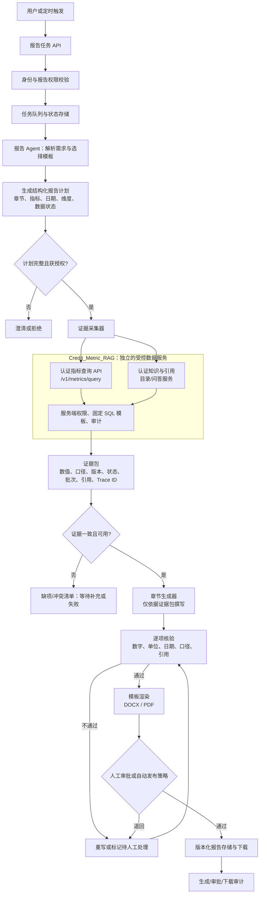

# 报告生成 Agent：初步架构

参考项目：`/Users/lxy/Documents/ChatGPT/Credit_Metric_RAG`。下图是目标设计；实现状态见图后说明。

## 当前实现状态

已实现首版单日报告路径：受 OIDC 保护的 HTTP 任务 API、提交人绑定和任务状态查询、审批待办列表、草稿/证据下载、审批人 API 发布、SQLite 队列与 worker、认证 API 取数、三项指标证据核验、Markdown 草稿与 JSON 证据清单、DOCX/PDF 渲染、人工检查后的哈希校验、OIDC 审批身份适配、SQLite 审批账本和版本化本地发布记录。任务提交、查看、下载和审批动作均写入独立审计事件表，并提供 auditor 角色查询接口。已使用参考项目的合成数据通过本地 API 联调。

仍未实现结构化需求澄清、生成式章节撰写和定时触发。首版报告流程使用固定模板及确定性文字。当前 SQLite 队列适用于单机部署；OIDC API 和审批逻辑尚未接入真实身份源，生产 JWT/JWKS 联通验收仍待完成。

## 总体进度

按首版“日报生成、异步任务、人工审批发布、审计追溯”的代码范围估算约 **97%**。报告取数与核验、草稿导出、任务 API、文件下载、审批发布、动作审计、瞬时服务故障重试、失败尝试产物清理、worker 错误日志、Python 包安装入口及本机合成数据演示栈均已实现；剩余工作集中在真实身份源与 Credit_Metric_RAG 服务凭证的环境联调、端到端验收，以及部署配置。定时调度、多机队列和生成式分析属于后续扩展，不计入首版完成度。

## 组件边界

| 组件 | 职责 |
| --- | --- |
| 报告任务 API | 首版接收单日信贷日报日期，校验 OIDC 用户权限，绑定任务提交人，返回任务状态和受权限控制的文件下载；审批人可查看待办并通过 API 发布草稿。 |
| 报告 Agent | 组织步骤、处理澄清与失败；不自行计算认证指标或决定数据权限。 |
| 证据采集器 | 首版通过部署配置的最小权限服务令牌访问受控服务，整理带来源、版本和状态的证据包；尚未将终端用户身份委托给 Credit_Metric_RAG。 |
| 章节生成与核验 | 模型撰写叙述；程序核验所有数值、单位、日期、引用及章节完整性。 |
| 渲染与审批 | 固定模板生成文件；按报告类型决定是否需人工审批，再发布版本。 |

## 与参考项目的集成契约

1. 指标取数优先使用现有 `POST /v1/metrics/query`，明确 `metric_id`、日期、`data_status=FINAL`、分组维度；正式报告默认只接纳已认证的 FINAL 数据。
2. 口径、字段、血缘使用参考项目的认证目录/问答能力，保留引用和目录版本；不直接读取其 SQLite、Elasticsearch 或会话状态。
3. 每个报告保存请求参数、模板版本、证据快照或可验证引用、指标版本、数据批次/发布时间、生成模型与提示词版本、审计 Trace ID，确保可追溯和重生成。
4. 当前 `Result` 已返回 `rows`、`citations`、`data_status`、`trace_id`，但正式集成还需稳定的机器可读契约：指标版本、单位、聚合语义、完整的数据水位线、错误码与批量查询一致性。可在参考服务新增面向报告的只读证据接口，避免从自然语言回答中解析这些字段。

## 建议的首版范围

先做一种固定模板的周期报告：单一身份、指定日期范围、少量已认证指标、FINAL 数据、DOCX/PDF 导出、人工发布。首版把“证据包 + 数值核验 + 可追溯下载”跑通，再扩展多模板、定时触发和自动审批。

## Grill check

- 主要假设：报告面向内部业务人员，正式报告只使用已认证 FINAL 数据。
- 最大风险：目前问答结果契约偏展示用途，跨指标报告可能混用不同目录版本或数据批次。
- 下一决策：确定首个报告模板、必填指标、时间范围以及审批人；据此冻结证据接口与验收样例。
